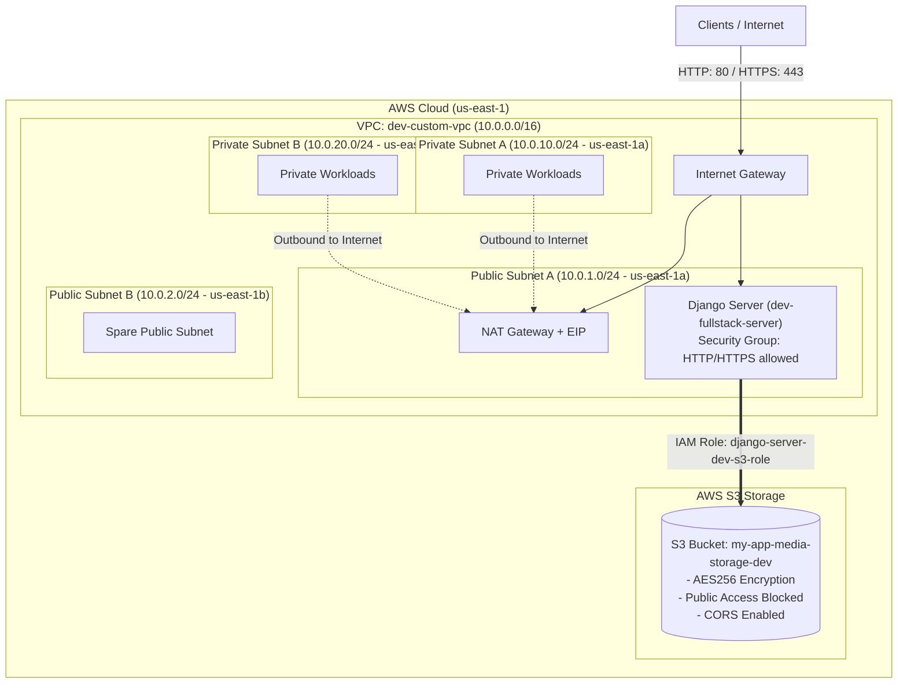

# M-TREAT Patient Registration System

A full-stack healthcare web application designed to streamline patient registration, medical records, and media uploads. Built with Django REST Framework, React/Redux, and fully automated AWS cloud infrastructure provisioned via Terraform and LocalStack.

---

## 🏛️ Cloud Infrastructure Architecture

The application's cloud infrastructure is fully written in **Terraform** and tested locally using **LocalStack** to ensure zero-cost, production-grade cloud emulation.



### Infrastructure Highlights
- **VPC & Networking:** Custom `10.0.0.0/16` VPC across 2 Availability Zones (`us-east-1a`, `us-east-1b`) with isolated public and private subnets.
- **Routing:** Internet Gateway for public traffic and an AWS NAT Gateway with Elastic IP for private subnet outbound requests.
- **IAM Security:** EC2 assumes an IAM role (`django-server-dev-s3-role`) via an instance profile to communicate with S3 without hardcoded access keys.
- **Storage:** S3 bucket configured with SSE AES-256 encryption, public access blocking, CORS policies, and multipart lifecycle cleanup.

---

## 🚀 Infrastructure Setup (LocalStack)

To provision the infrastructure locally without incurring AWS charges:

1. Ensure Docker and LocalStack are running:


2. Navigate to the terraform directory and run:
```bash
cd terraform/environments/dev
tflocal init
tflocal apply -auto-approve
```

---

## 📁 Project Structure

```text
├── .github/          # GitHub Actions CI/CD workflows
├── accounts/         # Django app: Authentication & user management
├── backend/          # Django core settings & API routing
├── frontend/         # React Redux frontend application
├── kubernetes/       # Kubernetes manifests (Deployments, Services)
├── patients/         # Django app: Patient registration & records
├── terraform/        # Infrastructure as Code (VPC, EC2, S3, IAM)
├── compose.yml       # Docker Compose for containerized environment
├── manage.py         # Django CLI entrypoint
├── README.md
└── requirements.txt  # Python backend dependencies
```

## 🗺️ Roadmap & Next Steps

Current deployment is **Phase 1 (Single Server Setup)**. Planned future enhancements include:
- [ ] Add an Application Load Balancer (ALB) to distribute incoming traffic.
- [ ] Add an Auto Scaling Group (ASG) to handle traffic spikes.
- [ ] Migrate the local PostgreSQL database to Amazon RDS inside the private subnets.